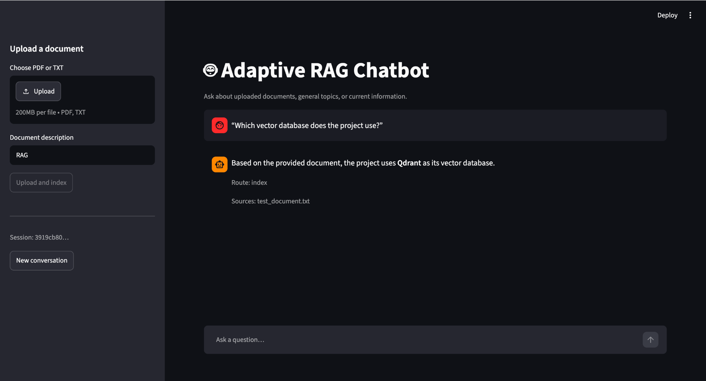
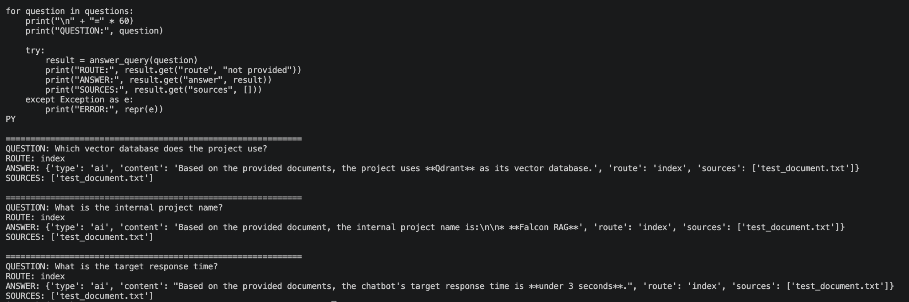

# Adaptive RAG Chatbot

An Adaptive Retrieval-Augmented Generation (RAG) chatbot that routes user queries through document retrieval, general-purpose responses, or web search depending on the query and available knowledge sources.

## Demo

### Chatbot Interface



### RAG Retrieval Tests



## Features

- **Adaptive query routing** using LangGraph.
- **Document ingestion and retrieval** with vector search.
- **Gemini integration** for language generation and embeddings.
- **Qdrant vector database** for storing and retrieving document embeddings.
- **FastAPI backend** for chatbot and document-upload endpoints.
- **Streamlit interface** for interacting with the chatbot.
- **Optional web search** for questions about current information.
- **Source-aware responses** that identify the documents used for retrieval.

## Tech Stack

| Component | Technology |
|---|---|
| Language | Python |
| LLM and embeddings | Google Gemini |
| RAG orchestration | LangGraph |
| Vector database | Qdrant |
| Backend API | FastAPI |
| Frontend | Streamlit |
| Web search | Tavily (optional) |

## Architecture

1. **User query:** The user submits a question through the Streamlit interface.
2. **Query analysis:** The LangGraph workflow determines the appropriate processing route.
3. **Retrieval:** For document-based questions, relevant passages are retrieved from Qdrant.
4. **Generation:** Gemini generates a response using the retrieved context when available.
5. **Web search:** Current-information queries can be routed to web search when configured.
6. **Response:** The answer and available source information are returned to the user.

## Getting Started

### Prerequisites

- Python installed
- A Google Gemini API key
- Optional: a Tavily API key for web search

### Installation

Clone the repository:

```bash
git clone YOUR_GITHUB_REPOSITORY_URL
cd adaptive-rag-chatbot
```

Create and activate a virtual environment on macOS:

```bash
python3 -m venv .venv
source .venv/bin/activate
```

Install the project's dependencies:

```bash
pip install -r requirements.txt
```

### Environment Configuration

Create a `.env` file in the project root and configure the environment variables expected by the application.

Example:

```env
GOOGLE_API_KEY=your_gemini_api_key
GEMINI_CHAT_MODEL=gemini-3.5-flash-lite
GEMINI_EMBEDDING_MODEL=gemini-embedding-001
```

Check the application's configuration for the exact variable names and any additional required settings. Never commit your actual API keys or `.env` file to GitHub.

### Run the Application

Start the FastAPI backend in one terminal:

```bash
uvicorn src.main:app --reload --port 8000
```

Start the Streamlit interface in another terminal:

```bash
streamlit run streamlit_app.py
```

The default local addresses are:

- Streamlit: http://localhost:8501
- FastAPI: http://localhost:8000
- API documentation: http://localhost:8000/docs

## Testing

The RAG pipeline was manually tested with an indexed sample document. The following questions returned the expected information with the `index` route and `test_document.txt` as the source:

- Which vector database does the project use? — Qdrant
- What is the internal project name? — Falcon RAG
- What is the target response time? — Under 3 seconds

These are functional retrieval checks, not a formal performance benchmark.

## Project Structure

```text
adaptive-rag-chatbot/
├── src/
│   ├── main.py
│   └── rag.py
├── streamlit_app.py
├── requirements.txt
├── .env                 # Local secrets; do not commit
├── .gitignore
└── README.md
```

The exact project structure may include additional configuration, test, or utility files.

## Security

- Keep API keys in environment variables.
- Do not commit `.env`, virtual environments, or local vector database data.
- Use `.env.example` with placeholder values if you want to document configuration.

## Future Improvements

- Add automated unit and integration tests.
- Improve retrieval quality with evaluation metrics.
- Add support for additional document formats.
- Add deployment configuration and monitoring.
